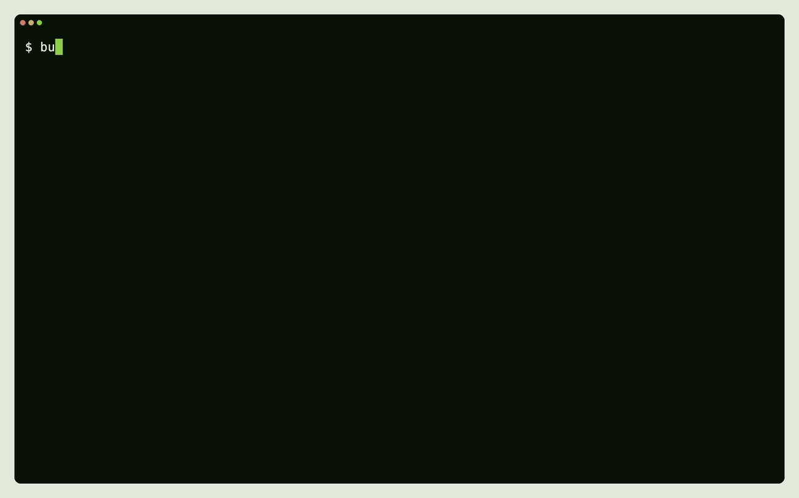

<!-- markdownlint-disable MD033 MD045 -->

<h1 align="center">Butler Sheet Icons</h1>

<strong>Automatic sheet icons for client-managed Qlik Sense and Qlik Cloud</strong>

<a href="https://butler-sheet-icons.ptarmiganlabs.com">Documentation</a> ·
<a href="https://github.com/ptarmiganlabs/butler-sheet-icons/discussions">Questions</a> ·
<a href="https://github.com/ptarmiganlabs/butler-sheet-icons/issues">Report a bug</a> ·
<a href="https://github.com/sponsors/ptarmiganlabs">❤️ Sponsor</a>

  

A cross-platform, command-line tool (plus Docker!) for creating sheet thumbnails based on the
actual layout of sheets in Qlik Sense apps. Works on both Qlik Sense Cloud apps and Qlik Sense
Enterprise on Windows (QSEoW) apps.

## ❤️ Support the project

Butler Sheet Icons is free and open source, under the MIT licence. If you use it, please consider sponsoring its development: sponsorships pay for maintenance, bug fixes and new features, and keep the project going.

**[❤️ Sponsor Ptarmigan Labs on GitHub](https://github.com/sponsors/ptarmiganlabs)**

Other ways to help:

- ⭐ **Star the repository**: it helps others find the project.
- 💬 **Share your feedback** in [Discussions](https://github.com/ptarmiganlabs/butler-sheet-icons/discussions): tell us how you use it.
- 🐛 **Report issues** in [Issues](https://github.com/ptarmiganlabs/butler-sheet-icons/issues).
- 🍴 **Contribute**: pull requests are welcome.

_Maintained by [Göran Sander](https://github.com/mountaindude) and supported by [Ptarmigan Labs](https://ptarmiganlabs.com)._

---

## Key Features

- Cross-platform support: Windows, macOS, Linux, and Docker.
- Automatically create sheet thumbnails based on actual sheet layouts.
- Supports Qlik Sense Cloud and Qlik Sense Enterprise on Windows (QSEoW).
- Multi-app support using tags (QSEoW) or collections (QS Cloud).
- Ability to exclude or blur specific sheets.
- Stand-alone binaries available for easy installation.
- Integration with CI/CD pipelines.

## Why Butler Sheet Icons?

Butler Sheet Icons ("BSI") removes the manual toil of curating sheet icons by mimicking how real users navigate Sense apps, capturing screenshots, processing them, and pushing the results back through the Sense APIs. Whether you are updating a single flagship dashboard or every app tagged for a release, BSI keeps thumbnails accurate and consistent.

Teams use BSI everywhere from ad-hoc desktop scripting to Dockerized CI/CD jobs. Built-in browser automation, sheet exclusion/blur filters, and environment-variable driven configs make it fit both quick experiments and enterprise deployments.

## Documentation (Start Here)

**👉 All installation guides, configuration references, examples, and troubleshooting now live at [butler-sheet-icons.ptarmiganlabs.com](https://butler-sheet-icons.ptarmiganlabs.com).**

The documentation site covers:

- Quick start flows for Qlik Sense Cloud and QSEoW
- Installation options (standalone binaries, Docker, Node.js)
- Command/option references and environment variables
- Hands-on examples, supported Sense versions, and troubleshooting tips

## Get Going

1. [Download the latest release](https://github.com/ptarmiganlabs/butler-sheet-icons/releases/latest) for your platform (Windows, macOS, Linux, Docker).
2. Head to the [Quick Start guide](https://butler-sheet-icons.ptarmiganlabs.com/guide/quick-start) to configure credentials, certificates, and first runs.
3. Explore advanced topics (collections/tags, blurring, CI/CD) in the [Guide](https://butler-sheet-icons.ptarmiganlabs.com/guide/introduction) and [Reference](https://butler-sheet-icons.ptarmiganlabs.com/reference/commands) sections.

---

Butler Sheet Icons is an open-source project sponsored by [Ptarmigan Labs](https://ptarmiganlabs.com). For support and services relating to the Butler family of tools or Qlik Sense projects in general, please contact info -at- ptarmiganlabs -dot- com, or [sign up to the newsletter](https://ptarmiganlabs.com/#/portal/signup) to get the latest updates.
